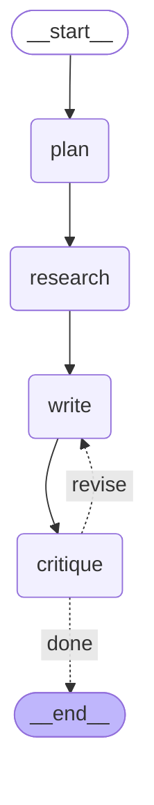

# Lab 9 — the essay-writer graph

This diagram is **generated from the compiled graph**, not drawn by hand — it is literally
what `build_graph().get_graph().draw_mermaid()` emits, so it cannot drift from the code.
GitHub renders the block below as a picture; view this file on GitHub to see it.



The same structure as a plain edge list, which is what `explore.ipynb` §6 prints:

```text
nodes: ['__start__', 'plan', 'research', 'write', 'critique', '__end__']

  __start__  --> plan      
  critique   ..> __end__     [done]
  critique   ..> write       [revise]
  plan       --> research  
  research   --> write     
  write      --> critique  
```

**Reading it.** `plan -> research -> write -> critique` is the straight run. The two **dotted**
edges out of `critique` are the conditional pair: `should_continue` reads State and returns the
label `revise` or `done`, and `add_conditional_edges` maps that label to `write` or to `END`.
That fork *is* the reflect/revise loop — it lives on the **edge**, not inside any node.

To regenerate after changing the graph:

```sh
python -c "from essay_writer import build_graph; print(build_graph().get_graph().draw_mermaid())"
```
